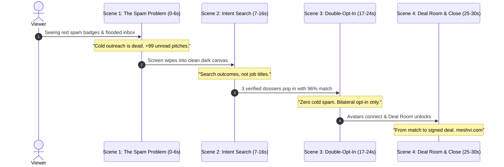

# MESHVI: 30-Second Animated Product Video Production Blueprint

## Overview
This specification details the visual assets, kinetic typography, motion graphics, and audio pacing for producing the official **30-second animated explainer video** for MESHVI.

---

## 1. Video Specifications
* **Target Duration**: Exactly 30 seconds (or 60s extended cut).
* **Frame Rate**: 60 fps (ultra-smooth motion).
* **Resolution**: 4K UHD (3840×2160) & 1080p Web (1920×1080).
* **Aspect Ratios**:
  * 16:9 Landscape (Hero website video, desktop, pitch decks).
  * 9:16 Vertical (LinkedIn video, Twitter/X, mobile showcase).
* **Visual Aesthetic**: High-contrast, dark glassmorphism (slate-950, deep navy `#0B1528`), electric cyan accents (`#38BDF8`), emerald verification glows (`#10B981`), and floating frosted glass cards.

---

## 2. Scene-by-Scene Storyboard & Keyframes

---

### Scene 1: The Noise & Friction (0:00 – 0:06)
* **Visual Action**:
  * A realistic mockup of a noisy email client and LinkedIn inbox.
  * Rapid red notification bubbles pop up: `"+99 Unread"`, `"Cold sales pitch"`, `"Quick question?"`.
  * The interface shakes subtly to convey overwhelm, then is smoothly swept away with a calming, clean dark gradient wipe.
* **On-Screen Typography**:
  * *"Cold B2B outreach is broken by noise."*
* **Sound Design**:
  * Soft rapid notification pings building up, followed by a crisp whoosh wipe.

---

### Scene 2: The Intent Engine (0:07 – 0:16)
* **Visual Action**:
  * A sleek, floating frosted glass search pill appears in the center with a glowing cyan border.
  * A cursor types smoothly with kinetic spring:
    `"Looking for AS9100 Rev D titanium forging suppliers in India or UK"`
  * Upon pressing Enter, the search bar morphs into a radial pulse.
  * Three floating 3D/2.5D executive cards glide in with smooth momentum:
    * **Dr. Vikram Malhotra** (COO &bull; Bharat Precision &bull; 96% Match &bull; Green DNS Shield).
    * **Alistair Sterling** (VP Supply Chain &bull; Sterling Alloys UK &bull; 93% Match).
    * **Elena Rostova** (Global Procurement &bull; 91% Match).
* **On-Screen Typography**:
  * *"Search outcomes, not job titles."*
* **Sound Design**:
  * Soft mechanical keyboard typing &rarr; satisfying futuristic chime &rarr; card glide whooshes.

---

### Scene 3: Bilateral Double-Opt-In (0:17 – 0:24)
* **Visual Action**:
  * Two profile avatars appear on opposite sides of the screen.
  * The user sends an intent note: *"Direct Supplier Sourcing"*.
  * A pulsing neon laser line shoots from the left avatar to the right counterparty.
  * The counterparty card flips with an animated checkmark: **"Accepted &bull; Mutual Consent Verified"**.
  * Both cards lock together seamlessly.
* **On-Screen Typography**:
  * *"100% Bilateral Opt-In. Zero Spam."*
* **Sound Design**:
  * Energizing synth riser &rarr; mechanical lock click &rarr; confirmation chime.

---

### Scene 4: Private Deal Room & Call to Action (0:25 – 0:30)
* **Visual Action**:
  * The locked cards morph into an isometric digital vault with a glowing lock icon.
  * The vault unfolds smoothly into a modern Deal Room timeline:
    * `[✓ Mutual NDA Signed]`
    * `[Milestone 3 of 4: Sample Audit]`
  * The scene transitions to the glowing **MESHVI** mark and tagline.
* **On-Screen Typography**:
  * *"From match to signed deal."*
  * *"The Intent-First Enterprise Network. meshvi.com"*
* **Sound Design**:
  * Confident ambient beat &rarr; clean final logo chord.

---

## 3. Recommended Production Tools
1. **Jitter.video**:
   * Fastest tool for vector UI motion graphics and Figma-to-video pipelines. Export to 4K MP4 or WebM at 60fps.
2. **Remotion (React-to-MP4)**:
   * Programmatic video generation using Tailwind CSS and React components already built in `apps/frontend`.
3. **Adobe After Effects + Lottie**:
   * For ultra-buttery 2.5D kinetic motion graphics and SVG loops.

---

## 4. Website Deployment
* Once exported, place the file in:
  `apps/frontend/public/videos/meshvi-explainer.mp4`
* It will automatically be picked up by [`AnimatedVideoModal.tsx`](file:///c:/Users/USER/Documents/vedasynk-applications/PROJECT-SETU/apps/frontend/src/components/ui/AnimatedVideoModal.tsx) via the `videoSrc` prop!
